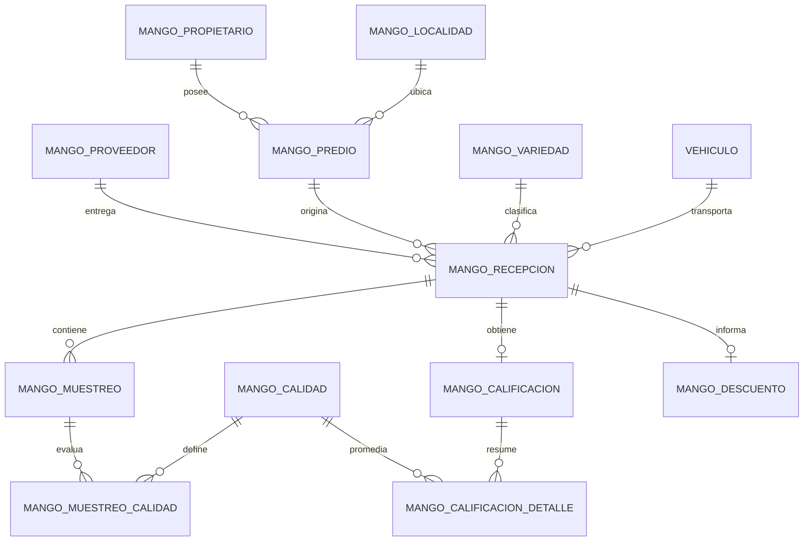

# Plan de implementación - Recepción de Mango

## Seguimiento de decisiones

Este documento es la fuente única de seguimiento funcional y técnico del
módulo. Toda pregunta que requiera una decisión del usuario debe agregarse a la
sección **Dudas pendientes**. Una vez contestada y validada, la respuesta debe
integrarse en las reglas o decisiones confirmadas y eliminarse de pendientes.

## 1. Decisión de arquitectura

La Recepción de Mango se implementará como un módulo independiente dentro de la
aplicación WinForms existente. Compartirá únicamente infraestructura transversal:

- autenticación, sesión, permisos y auditoría;
- catálogo de vehículos;
- utilerías de formularios y ReportViewer;
- conexión de Entity Framework 6 a SQL Server Express.

No se reutilizarán las tablas `Recepciones`, `Tarimas`, `Calidades`,
`CalidadesRecepciones`, `MuestreosRecepciones` ni
`MuestreosCalidadesRecepciones` para registrar Mango.

Motivos:

- el peso de Fresa se obtiene de tarimas y el de Mango de un ticket de báscula;
- Mango no registra peso por tarima;
- las calidades de Mango deben ser independientes;
- el flujo de Mango requiere guía sanitaria obligatoria;
- cambiar el flujo actual pondría en riesgo la operación terminada de Fresa.

> Nota: el Documento 2 menciona WebForms, pero el repositorio real es WinForms
> .NET Framework 4.7.2. Para esta implementación, el repositorio es la fuente de
> verdad tecnológica.

## 2. Modelo funcional propuesto

### Catálogos propios de Mango

- `MangoProveedores`
- `MangoPropietarios`
- `MangoLocalidades`
- `MangoPredios`
- `MangoVariedades`
- `MangoCalidades`

### Operación

- `MangoRecepciones`
- `MangoMuestreos`
- `MangoMuestreosCalidades`
- `MangoCalificaciones`
- `MangoCalificacionesDetalles`
- `MangoDescuentos`

`MangoRecepciones` guardará como mínimo la guía sanitaria, proveedor, predio,
variedad, vehículo, conductor, referencia del ticket de báscula, peso neto,
fecha, estado y auditoría. No tendrá relación con `Tarimas`.

No se configurará ni almacenará una cantidad requerida de muestreos. El usuario
podrá agregar, editar o eliminar muestras según la operación. Cada cambio
recalculará el promedio por calidad, la calificación general y el grado.

La “muestra general” será un resultado agregado de solo lectura, equivalente al
promedio general utilizado en Fresa. No será una muestra adicional editable.

## 3. Reglas que deben protegerse en base de datos

- La guía sanitaria es obligatoria, tendrá una longitud máxima de 250
  caracteres y será única por recepción.
- Cada calidad aparece una sola vez por muestreo.
- Al crear un muestreo se generan todas las calidades aplicables con valor
  inicial cero.
- Cada valor de calidad será un entero entre 0 y 100.
- Después de crear, editar o eliminar un muestreo se recalculan los resultados
  agregados de la recepción.
- El promedio de cada calidad se redondea a cero decimales; los valores con
  fracción `.5` suben.
- La calificación general es `100 - suma(promedios redondeados)`, con límite
  inferior de cero.
- La calificación se genera mediante procedimiento almacenado y no se acepta
  como parámetro editable desde WinForms.
- El grado se determina automáticamente mediante los rangos configurados para
  Mango.
- La aceptación o rechazo la decide el usuario y es independiente del grado.
- El rechazo no requiere motivo; las observaciones son opcionales.
- Una recepción puede permanecer activa sin muestras.
- Las recepciones no tendrán un estado final de auditada o cerrada. Mientras
  estén activas podrán modificarse sin un permiso especial.
- La pantalla de muestreos mostrará la cantidad actual de muestras de la
  recepción.
- Cuando una recepción con muestras sea actualizada después de agregar una
  calidad al catálogo, la nueva calidad se agregará con valor cero a todas sus
  muestras. Los reportes también mostrarán cero cuando todavía no exista el
  detalle físico.
- El descuento se mantendrá separado y será únicamente informativo mientras se
  define su efecto. Nunca modificará el peso neto oficial.
- Las bajas serán lógicas para preservar trazabilidad.
- Todos los registros operativos conservarán usuario y fecha de creación y
  modificación.

## 4. Procedimientos almacenados previstos

1. `sp_MangoRecepcion_Crear`
2. `sp_MangoRecepcion_Actualizar`
3. `sp_MangoRecepcion_Obtener`
4. `sp_MangoRecepcion_Listar`
5. `sp_MangoGuiaSanitaria_Existe`
6. `sp_MangoMuestreo_Guardar`
7. `sp_MangoMuestreo_Eliminar`
8. `sp_MangoRecepcion_Recalcular`
9. `sp_MangoPapeleta_Obtener`
10. `sp_MangoReporteRecepciones`
11. `sp_MangoReporteMuestreos`

Los procedimientos de escritura usarán transacciones y validarán las reglas de
negocio, aunque la pantalla también las valide.

## 5. Pantallas WinForms

### Catálogos

- Proveedores
- Propietarios
- Localidades
- Predios
- Variedades de Mango
- Calidades de Mango

### Operación

- Bandeja de Recepciones de Mango
- Captura/edición de Recepción de Mango
- Captura de Muestreos de Mango
- Consulta de promedio, calificación y grado (solo lectura)
- Impresión de papeletas

El menú mostrará “Recepción de Fresa” y “Recepción de Mango” como opciones
separadas y con permisos independientes.

## 6. Reportes iniciales

- Papeleta de recepción
- Detalle de recepción y ticket de báscula
- Resultado de muestreos y calificación
- Recepciones por rango de fechas
- Recepciones por proveedor, propietario, predio y variedad

Los formatos se implementarán en RDLC y consumirán resultados de procedimientos
almacenados, siguiendo el patrón existente de ReportViewer.

## 7. Entregas

### Entrega 1 - Base de datos

- scripts idempotentes de tablas, llaves, índices y restricciones;
- procedimientos de catálogos y recepción;
- datos iniciales de permisos;
- script de reversión para ambiente de desarrollo;
- pruebas SQL de reglas críticas.

### Entrega 2 - Modelos y controladores

- entidades EF6 del módulo Mango;
- view models;
- controladores con transacciones y manejo de errores;
- pruebas de integración contra una base de desarrollo.

### Entrega 3 - Catálogos y recepción

- formularios de catálogo;
- bandeja y captura de recepción;
- navegación y permisos;
- validación de guía, báscula y estado.

### Entrega 4 - Muestreo y calificación

- alta, edición y eliminación libre de muestreos;
- captura completa de calidades con valor inicial cero;
- recálculo automático después de cada cambio;
- cálculo no editable;
- pruebas de casos límite.

### Entrega 5 - Papeletas y reportes

- datasets;
- RDLC;
- filtros e impresión;
- validación visual de formatos.

### Entrega 6 - Transpaleos

Fuera del alcance hasta contar con definición funcional y de trazabilidad.

## 8. Decisiones confirmadas

1. La guía sanitaria es texto libre, con capacidad de 250 caracteres y no puede
   repetirse entre recepciones.
2. No existe un número requerido de muestreos. El usuario administra libremente
   las muestras y todo cambio actualiza el resultado general.
3. Las calidades o defectos son números enteros de 0 a 100, sin unidad.
4. Todas las calidades aparecen inicialmente en cero dentro de cada muestra.
5. Se promedia cada calidad, se redondea con `.5` hacia arriba y después se
   resta la suma de promedios a 100.
6. La calificación nunca será menor que cero.
7. El grado se obtiene de la configuración de rangos de Mango.
8. El usuario determina aceptación o rechazo. No se exige motivo y las
   observaciones son opcionales.
9. Proveedor y propietario se administrarán en tablas separadas, aunque puedan
   representar a la misma persona.
10. El descuento queda informativo y pendiente de definición. No afecta el peso
    neto.
11. La papeleta de la recepción no tendrá firmas.
12. Los reportes generales solicitarán responsables al momento de imprimir,
    siguiendo el patrón actual de reportes de Fresa.
13. Los campos definitivos de la papeleta quedan pendientes de la imagen del
    formato de Mango.
14. Una recepción puede permanecer activa sin muestras. La pantalla mostrará
    el número actual de muestras para validación visual.
15. No existe un cierre o auditoría final de la recepción. Una recepción activa
    permanece disponible para modificaciones sin permisos especiales.
16. Si se agrega una calidad nueva, al actualizar una recepción se incorporará
    con valor cero a todas sus muestras. Los reportes interpretarán como cero
    cualquier detalle faltante.
17. No se permiten valores negativos en las calidades.
18. Los reportes conservarán los campos actuales de Fresa:
    `Responsable/Elabora` y `Firma Verifica`.
19. Proveedores, propietarios, predios y localidades tendrán inicialmente solo
    nombre y estado activo/inactivo.
20. Los reportes reutilizarán la cabecera actual y el logotipo almacenado en la
    tabla `Empresa`.
21. Los rangos de grados deben cubrir todo el intervalo 0-100 sin huecos y se
    bloquearán rangos traslapados.
22. Una recepción sin muestras tendrá calificación 100 y el grado que
    corresponda. La cantidad de muestras en cero permitirá identificar que no
    fue muestreada.
23. El peso neto no será obligatorio. Si no se captura se almacenará en cero y
    el sistema no bloqueará guardado, impresión ni reportes.
24. El cuerpo y los campos definitivos de la papeleta se definirán después. Esto
    no bloquea las entregas de base de datos, modelos, catálogos, recepción o
    muestreo.

## 9. Dudas pendientes

Agregar las respuestas directamente debajo de cada pregunta.

1. **Catálogos de producto existentes:** la base ya contiene la fruta `MANGO`,
   las variedades `KENT` y `KEIIT`, y el grado `A` para el rango 90-100.
   ¿Reutilizamos las tablas existentes `Frutas`, `Variedades` y `GradosFruta`
   para Mango, dejando únicamente las calidades en tablas independientes? Esta
   es la opción recomendada porque esos catálogos ya están separados por fruta.

   **Respuesta:** Si, usemos las mismas tablas no necesitamos crear mas.

2. **Catálogo completo de grados:** actualmente Mango solo tiene el grado
   `A = 90-100`, por lo que no cumple la regla de cubrir 0-100. Indicar los
   nombres y rangos de los grados faltantes.

   **Respuesta:** Dejaremos la funcionalidad actual y usaremos lo existente ya que actualmente para Fresas funciona bien asi.

3. **Catálogo de calidades:** indicar los nombres de las calidades o defectos
   iniciales de Mango. Confirmar también si todos restan a la calificación y si
   todos deben aparecer en reportes.

   **Respuesta:** Asi es, esos campos deben de existir para saber cuales afectan y cuales aparecen en reportes como en Fresas.

4. **Ciclos:** el proceso de Fresa relaciona cada recepción con `Ciclos`, pero
   los documentos de Mango no mencionan ciclos o temporadas. ¿Las recepciones
   de Mango deben relacionarse con el ciclo existente o serán independientes?

   **Respuesta:** Deberan de relacionarse tambien con el ciclo actual segun la fecha como en Fresas.

5. **Aceptación/rechazo:** confirmar si la decisión se registra una sola vez en
   la recepción general o individualmente en cada muestreo. Se recomienda
   guardarla en la recepción general y dejar los muestreos únicamente como
   evidencia de calidad.

   **Respuesta:** La regla es que se puede rechazar en la recepcion general o, si una muestra es rechazada se rechaza la recepcion general

## 10. Pendientes para una reunión posterior

1. Definir si el descuento informativo afectará posteriormente el importe. Por
   la regla RN-06 nunca podrá modificar el peso neto.
2. Definir si los catálogos de proveedor, propietario, predio y localidad
   necesitarán datos adicionales a nombre y estado.
3. Definir los campos y la distribución del cuerpo de la papeleta de Mango.

## 11. Estado para iniciar

La estructura general de la Entrega 1 ya puede comenzar: catálogos propios,
recepción, muestreos, detalle de calidades, resultado agregado, descuento
informativo, restricciones e índices.

Antes de cerrar los scripts y sus datos iniciales deben responderse las cinco
dudas de la sección anterior. Los reportes y transpaleos no bloquean el inicio y
permanecen fuera de esta primera construcción.
